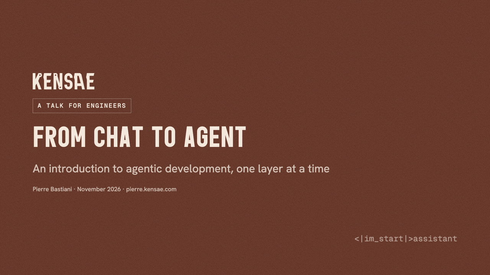
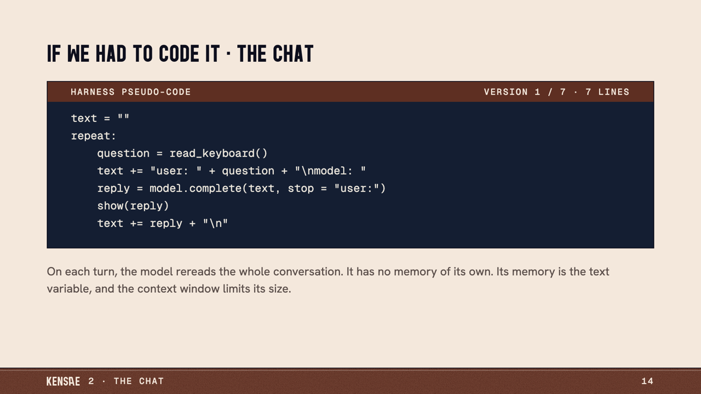
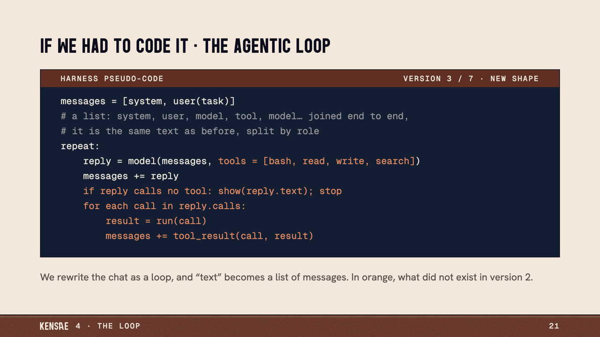
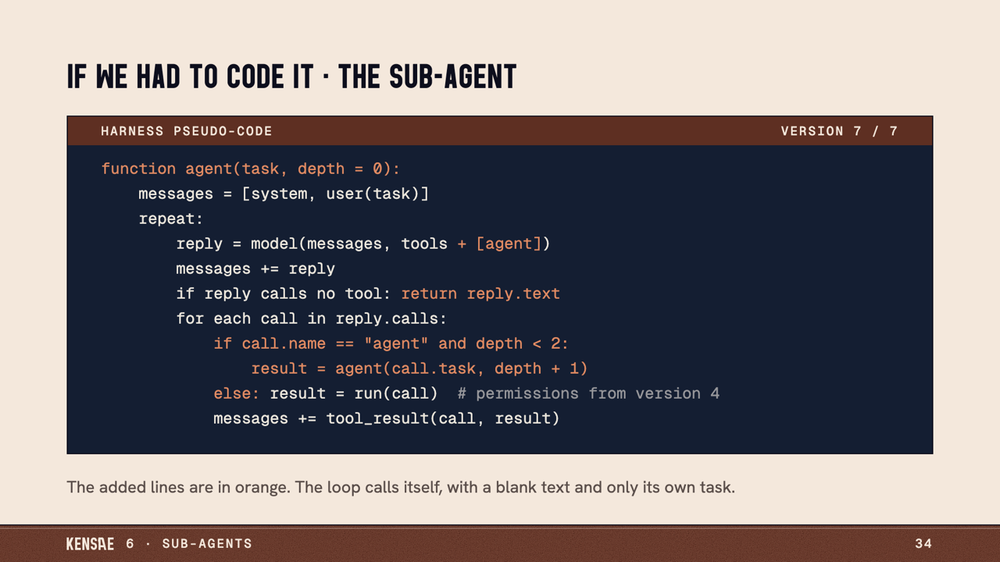
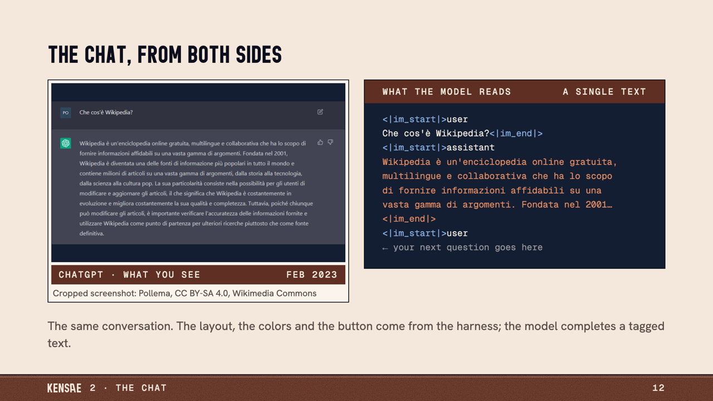
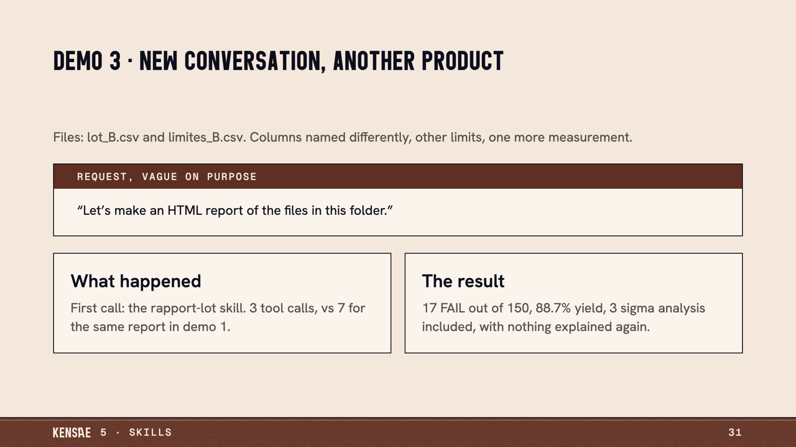

# From chat to agent

A talk that rebuilds an AI coding agent in pseudo-code, one layer at a time: the model, the chat, the first tool, the agentic loop, permissions, MCP, skills and sub-agents. It is written for engineers who use these tools every day without knowing what runs underneath. I first gave it in French, in Sophia Antipolis, in November 2026.

**[Open the deck](https://pierre.kensae.com/from-chat-to-agent/deck/)** · **[Download the video (23 min)](https://github.com/PierreBastiani/from-chat-to-agent/releases/latest/download/from-chat-to-agent.mp4)** · **[Download the PowerPoint](https://github.com/PierreBastiani/from-chat-to-agent/releases/latest/download/from-chat-to-agent.pptx)**

https://github.com/user-attachments/assets/a502777a-b3a5-4cde-b20c-2b88e37dd0ba

En français : **[le diaporama](https://pierre.kensae.com/from-chat-to-agent/deck/?lang=fr)** · **[le PowerPoint](https://github.com/PierreBastiani/from-chat-to-agent/releases/latest/download/du-chat-a-l-agent.pptx)** (la vidéo est en anglais).

[](https://pierre.kensae.com/from-chat-to-agent/deck/)

## The idea

Everything an agent does comes from a small program around the model, the harness. The model only completes text. The deck writes the harness seven times: version 1 is a seven-line chat, and each later version adds only what its step needs, in orange, so the agent appears line by line.

| Version | What it adds |
|---|---|
| 1 · the chat | a text variable, a loop, and a stop sequence so the model does not write the user's next question |
| 2 · the first tool | a second stop sequence, `</search>`: the model writes a query, the harness runs the search and pastes the results |
| 3 · the agentic loop | a list of messages and a list of tools; the loop stops when the model calls no tool |
| 4 · permissions | the harness asks "Allow?" before running bash, and the model reads the refusal |
| 5 · MCP servers | tools that come from external servers, which check access rights themselves |
| 6 · skills | at startup, each skill's name and description go into the system prompt; the model reads the file when it needs it |
| 7 · sub-agents | the loop becomes a function the model can call, with a maximum depth |

| Version 1 | Version 3 | Version 7 |
|---|---|---|
|  |  |  |

Around the pseudo-code, the slides show each generation from both sides: what the user sees, and the single text the model reads.



## Outline

1. **The model.** It predicts the next token, and it was trained twice: pre-training, then fine-tuning.
2. **The chat.** Raw completion, special tokens, the context window.
3. **The first tool.** Web search, written as tags.
4. **The loop.** Think, act, observe; bash, files, permissions, MCP, chain of thought.
5. **Skills.** A skill is a text file. A live demo turns a task into a skill.
6. **Sub-agents.** A short look ahead.
7. **Your harness.** What you can set in an agentic harness, and how to get started.
8. **Discussion,** then resources and a glossary in English and French.

## The demo

The demo data in [`demo/`](demo/) is made up: two lots of chips with their test limits, generated with a fixed seed by [`tools/generate_data.py`](tools/generate_data.py). The video narrates a real Claude Code session on that data:

1. "Find the chips outside the limits and make me an HTML report." The agent writes a Python script and runs it: 19 fails out of 200, a 90.5% yield.
2. "What is the failure rate at 3 sigma?" 17 chips fall outside μ ± 3σ, 8.5% of the lot, against about 1% for a normal distribution.
3. "Turn what we just did into a skill." The agent stores its script in the skill folder, next to a `SKILL.md`.
4. A new conversation, in a folder with another product, and a vague request: "Let's make an HTML report of the files in this folder." The agent opens the skill on its first call and finishes in 3 tool calls, against 7 the first time.



## Run the deck

```sh
python3 -m http.server 8000
open http://127.0.0.1:8000/deck/          # add ?lang=fr for the French slides
```

Arrow keys to move, `S` for the speaker notes, `F` for full screen. It works offline: reveal.js 5.1.0 and the fonts are vendored.

## How it is built

- [`deck/`](deck/): one HTML file per slide in `deck/slides/` (English) and `deck/slides-fr/` (French, same ids), in the order of `order.json`, loaded by `deck/index.html`. A small animation engine in `index.html` types text and code token by token and reveals lines in order when a slide arrives.
- [`voiceover/en.md`](voiceover/en.md): the narration, one section per slide.
- [`tools/`](tools/):
  - `preview.js` renders every slide in its final state as contact sheets, for review.
  - `export_pptx.js` writes a PowerPoint with one image per slide and the speaker notes ([pptxgenjs](https://github.com/gitbrent/PptxGenJS)).
  - `narrate.py` reads the narration with [Kokoro](https://github.com/thewh1teagle/kokoro-onnx), voice `af_heart`, on CPU.
  - `check_voice.py` transcribes the narration with Whisper, to catch mispronounced words.
  - `make_video.js` films the deck in real time through Chrome's screencast, holds each slide for its narration, resamples to 30 fps and muxes the audio with ffmpeg.
  - `glossary.py` builds the glossary slides, and `render_capture.js` draws the terminal captures.

To rebuild the PowerPoint and the video:

```sh
npm install && npx playwright install chromium
python3 -m http.server 8000 &
node tools/export_pptx.js        # build/from-chat-to-agent.pptx
DECK_URL='http://127.0.0.1:8000/deck/?lang=fr' node tools/export_pptx.js build/fr/du-chat-a-l-agent.pptx
python tools/narrate.py          # build/audio/en/, see the setup notes at the top of the file
node tools/make_video.js         # build/from-chat-to-agent.mp4, runs in real time
```

## Credits and licenses

- Code and slides: MIT, see [`LICENSE`](LICENSE).
- [reveal.js](https://revealjs.com) 5.1.0: MIT, in [`deck/vendor/`](deck/vendor/).
- Hanken Grotesk and Geist Mono: SIL Open Font License, in [`deck/fonts/`](deck/fonts/).
- Kensae Sans (`deck/fonts/kensae-sans.woff2`), the titles and the wordmark: my own typeface, drawn for [pierre.kensae.com](https://pierre.kensae.com). It is not under the MIT license: all rights reserved.
- Two screenshots from Wikimedia Commons, under CC BY-SA 4.0: details in [`deck/img/SOURCES.md`](deck/img/SOURCES.md).
- Narration voice: Kokoro v1.0, Apache 2.0.
